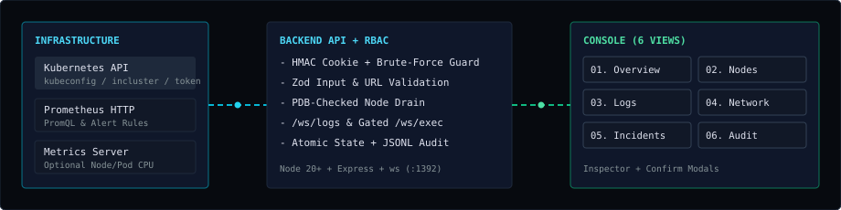

<div align="center">


<br />
<br />

```
[ React 19 ] ── [ TypeScript ] ── [ Tailwind CSS v4 ] ── [ Vite 8 ] ── [ License: MIT ]
```

**Cloud-native infrastructure observability, Kubernetes cluster telemetry, and live incident response console.**

[Architecture](#architecture) · [Core Screens](#core-screens) · [Quick Start](#quick-start) · [Interactive Capabilities](#interactive-capabilities) · [Design Tokens](#design-tokens) · [Contributing](#contributing)

</div>

---

## Overview

**Obsidian Telemetry** is an open-source, high-density observability console built for DevOps engineers, site reliability teams, and infrastructure architects. It combines dark-mode technical glassmorphism with zero-latency interactive controls across multi-region clusters, node fleets, structured container logs, SPIFFE mTLS service meshes, and PromQL alert rules.

<div align="center">
  
</div>

---

## Architecture

Every screen reads from and mutates a unified, `localStorage`-persisted cluster state engine. Actions performed in one view (e.g., draining a node, restarting a crashed pod, tripping an Envoy circuit breaker, or resolving an incident) propagate immediately across node event feeds, structured log buffers, PromQL rule evaluations, and overall cluster health status.

<div align="center">
  
</div>

### Repository Layout

```
obsidian-telemetry/
├── .github/
│   └── assets/
│       ├── obsidian-banner.svg        # Animated hero header SVG
│       ├── telemetry-pulse.svg        # Animated multi-channel sparkline SVG
│       └── architecture-flow.svg      # Animated dataflow diagram SVG
├── src/
│   ├── components/
│   │   ├── CommandPalette.tsx         # Cmd/Ctrl+K keyboard navigator + workspace reset
│   │   ├── IncidentsScreen.tsx        # Incident queue + live PromQL rule evaluator
│   │   ├── LogsScreen.tsx             # Embedded #070A0F log stream + regex + .log export
│   │   ├── ManifestModal.tsx          # YAML preview + pod deployment scheduler
│   │   ├── NetworkScreen.tsx          # Interactive SVG service mesh + ingress breaker table
│   │   ├── NodesScreen.tsx            # Fleet table, batch cordon, expandable pod workloads
│   │   ├── OverviewScreen.tsx         # KPI sparklines, multi-metric chart, node matrix
│   │   ├── SidebarRail.tsx            # Collapsible 64px/240px rail + cluster switcher
│   │   ├── Sparkline.tsx              # Interactive SVG sparklines & coordinate crosshair
│   │   ├── StatusBadge.tsx            # Accessible status pills (color + icon + label)
│   │   ├── TelemetryDrawer.tsx        # Persistent 360px inspector + live node exec shell
│   │   └── TopBar.tsx                 # Breadcrumbs, live stream toggle, Cmd+K, deploy CTA
│   ├── data/
│   │   └── mockClusters.ts            # Multi-region cluster topology & telemetry generator
│   ├── types/
│   │   └── telemetry.ts               # Strict TypeScript interfaces and enums
│   ├── App.tsx                        # State orchestration, persistence, and live stream loop
│   ├── index.css                      # Obsidian Telemetry theme tokens & utility classes
│   └── main.tsx                       # Application bootstrap
├── CODE_OF_CONDUCT.md
├── CONTRIBUTING.md
├── LICENSE                            # MIT License
├── SECURITY.md
└── package.json
```

---

## Core Screens

| Index | Screen | Primary Capabilities |
| :--- | :--- | :--- |
| `01` | **Cluster Overview** | 4-column KPI strip with hover crosshairs, multi-metric area chart (`CPU`, `Memory`, `Network Mbps`, `P99 Latency`), time-window selector (`15m`, `1h`, `6h`, `24h`), and active node matrix. |
| `02` | **Nodes & Workloads** | Live search by hostname/IP/CIDR/zone, status tabs, multi-node checkbox selection for batch `Cordon` / `Uncordon`, node draining with pod eviction, and expandable pod rows with SHA-256 digests and restarts. |
| `03` | **Live Log Stream** | Embedded `#070A0F` terminal console with 4px micro-scrollbars, live tail streaming, regex/text search, severity filters (`INFO`, `WARN`, `ERROR`, `TRACE`), expandable JSON payloads, and `.log` file export. |
| `04` | **Network Topology** | Interactive SPIFFE mTLS SVG service mesh graph with clickable nodes, plus an ingress route table with editable RPM rate-limit inputs and real-time circuit-breaker toggles. |
| `05` | **Incidents & Alerts** | Incident triage workflow (`Acknowledge`, `Resolve`, remediation runbooks, event timelines) paired with live PromQL threshold rules that evaluate firing targets dynamically as thresholds change. |

---

## Interactive Capabilities

All controls are backed by live state mutations rather than static mockups:

- **Persistent 360px Contextual Inspector (`TelemetryDrawer`)**: Clicking any node, pod, mesh service, or incident opens deep telemetry, copyable IPs/SHA digests, node lifecycle events, and an interactive **Node Exec Console**.
- **Live Node Exec Shell**: Supports `help`, `kubectl get pods`, `free -m`, `ip addr`, `df -h`, `top`, `uname -a`, `uptime`, and `clear`, returning live data from the inspected node's current React state.
- **Deploy Workload Manifest**: Triggered from the top bar (`Deploy Manifest`), generates a live Kubernetes YAML Deployment preview and schedules a new pod onto the chosen node, incrementing pod counts and writing audit logs.
- **Keyboard Command Palette (`Cmd+K` / `Ctrl+K`)**: Supports `ArrowUp`, `ArrowDown`, `Enter`, and `Esc` to switch screens, change clusters, inspect nodes/pods, or reset persisted `localStorage` workspace state.

---

## Quick Start

### Prerequisites

- Node.js `>= 20.x`
- npm `>= 10.x`

### Local Development

```bash
git clone https://github.com/your-username/obsidian-telemetry.git
cd obsidian-telemetry
npm install
npm run dev
```

The development server starts on `http://localhost:3000`.

### Production Build & Type Check

```bash
npm run lint
npm run build
npm run preview
```

---

## Design Tokens

Obsidian Telemetry uses an engineered dark-mode palette paired with tabular monospace telemetry:

```
Canvas Base          #0B0F17   ── 24px dot-matrix technical floor
Terminal Surface     #070A0F   ── Embedded log & exec console backing
Elevation 1 (Panel)  #0F172A   ── Frosted glass (70% alpha + 12px blur)
Primary Telemetry    #06B6D4   ── Active links, focus rings, primary actions
Health / Nominal     #10B981   ── Healthy workloads, mTLS verified
Warning / Degraded   #F59E0B   ── Memory pressure, elevated P99 latency
Critical / Alert     #EF4444   ── OOMKill loops, open circuit breakers
```

Typography pairs **Plus Jakarta Sans** (headings), **DM Sans** (UI prose), and **JetBrains Mono** with `tabular-nums` for IPs, CIDR blocks, SHA-256 digests, and timestamps.

---

## Open Source & Contributing

Obsidian Telemetry is free and open-source under the [MIT License](./LICENSE).

- Read [CONTRIBUTING.md](./CONTRIBUTING.md) for development guidelines and PR standards.
- Read [CODE_OF_CONDUCT.md](./CODE_OF_CONDUCT.md) for community expectations.
- Report security issues following [SECURITY.md](./SECURITY.md).
