<div align="center">


<br />
<br />

```text
[ CLI: ot ] ── [ Node.js 20+ · Express · ws ] ── [ React 19 ] ── [ Kubernetes + Prometheus ] ── [ MIT ]
```

**Cross-platform self-hosted Kubernetes observability platform, Prometheus PromQL telemetry console, and RBAC-guarded operations CLI.**

[Quick Install](#installation) · [CLI Commands](#cli-usage) · [Operator Cast](#operator-personas) · [Architecture](#architecture) · [Security](#security-model) · [Persistence](#persistent-storage) · [Documentation Book](./docs/README.md) · [Testing](#testing)

</div>

---

## Overview

**Obsidian Telemetry** (`devlopergit04/Obsidian-Telemetry`) is an independent, MIT-licensed, self-hosted Kubernetes and Prometheus observability platform packaged as an npm CLI (`obsidian-telemetry`) with the single-command executable `ot`.

Running `ot` starts a production Express + WebSocket control plane and React 19 web dashboard bound to `0.0.0.0:1392` with zero external database, SaaS control plane, or Docker requirement. Local `scrypt` password credentials, HMAC session secrets, incident triage state, and operational JSONL audit trails remain strictly on host disk.

<div align="center">
  
</div>

> **Full Engineering & Operations Book**: Every architectural detail, API route, WebSocket frame, reverse proxy config, systemd/launchd/Windows service setup, and security checklist is documented across 13 chapters (Topics 1–41) in [docs/README.md](./docs/README.md).

---

## Installation

### Prerequisites

- **Node.js `>= 20.0.0`** (includes `npm`)
- Supported hosts: **Linux** (`x64`, `arm64`), **macOS** (Apple Silicon & Intel), **Windows 10/11/Server**

### Method A — Install via npm (Linux, macOS, Windows)

```bash
npm install -g obsidian-telemetry
ot
```

### Method B — Install Script for Linux & macOS (`install.sh`)

```bash
curl -fsSL https://raw.githubusercontent.com/devlopergit04/Obsidian-Telemetry/main/install.sh | sh
```

The POSIX installer verifies Node.js `>= 20`, installs `obsidian-telemetry` cleanly under `~/.local/share/obsidian-telemetry/npm` (without modifying system files or requiring root), links `~/.local/bin/ot`, and verifies `ot --version`.

### Method C — Install Script for Windows PowerShell (`install.ps1`)

Windows CMD and PowerShell do not execute POSIX shell scripts natively. Run the PowerShell installer in Windows PowerShell or PowerShell 7:

```powershell
irm https://raw.githubusercontent.com/devlopergit04/Obsidian-Telemetry/main/install.ps1 | iex
```

Or inspect and run locally:

```powershell
Invoke-WebRequest -Uri https://raw.githubusercontent.com/devlopergit04/Obsidian-Telemetry/main/install.ps1 -OutFile install.ps1
.\install.ps1
```

---

## CLI Usage

The executable command across Linux, macOS, and Windows is `ot`.

```text
Obsidian Telemetry

Status: Running
PID: 48210
Host: 0.0.0.0
Port: 1392

Dashboard: http://localhost:1392
Auth Mode: token

Initial Administrator Credentials (shown once):
  Username: admin
  Password: <generated-once-on-first-boot>
```

Remote access on LAN or VPN hosts defaults to `http://SERVER-IP:1392`. For HTTPS domain deployments, see [Reverse Proxies & TLS](./docs/03-reverse-proxy-tls-and-systemd.md).

### Commands

| Command             | Description                                                                                                 |
| :------------------ | :---------------------------------------------------------------------------------------------------------- |
| `ot` / `ot start`   | Start Obsidian Telemetry on `0.0.0.0:1392` (fails fast if another process owns the port).                   |
| `ot stop`           | Gracefully terminate the background daemon (`SIGTERM` + PID cleanup).                                       |
| `ot restart`        | Stop and cleanly relaunch the background service.                                                           |
| `ot status`         | Report running state, PID, listening address, auth mode, and reachable dashboard URLs.                      |
| `ot update`         | Safely stop the running daemon (preventing Windows file locks), upgrade via npm, and restart cleanly.       |
| `ot backup [file]`  | Export config, credentials, triage state, and audit logs into a SHA-256 checksummed JSON archive (`0600`).  |
| `ot restore <file>` | Verify SHA-256 integrity via `crypto.timingSafeEqual` and restore state safely with `.bak` recovery points. |
| `ot passwd [user]`  | Update or rotate local user password hashes (`scrypt`) interactively or via `--password`.                   |
| `ot uninstall`      | Stop the service and remove Obsidian Telemetry managed directories and package after confirmation.          |

Options: `-p, --port <port>`, `-H, --host <host>`, `-f, --foreground`, `-y, --yes`, `--password <value>`, `-v, --version`, `-h, --help`.

---

## Operator Personas

Original SVG character system designed for Obsidian Telemetry documentation (pure vector SVG, reduced-motion aware, zero external assets):

<table>
  <tr>
    <td align="center" width="25%">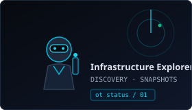<br /><sub><a href="./docs/01-introduction-and-quickstart.md">Start &amp; Discovery</a></sub></td>
    <td align="center" width="25%">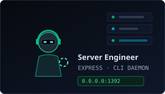<br /><sub><a href="./docs/02-cli-and-networking.md">CLI &amp; Networking</a></sub></td>
    <td align="center" width="25%">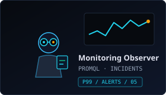<br /><sub><a href="./docs/07-kubernetes-and-prometheus.md">Telemetry &amp; PromQL</a></sub></td>
    <td align="center" width="25%">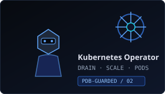<br /><sub><a href="./docs/09-deployment-containers-and-k8s.md">Kubernetes RBAC</a></sub></td>
  </tr>
  <tr>
    <td align="center" width="25%">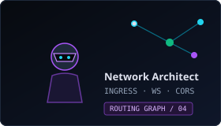<br /><sub><a href="./docs/03-reverse-proxy-tls-and-systemd.md">Proxies &amp; Ingress</a></sub></td>
    <td align="center" width="25%">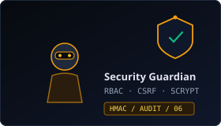<br /><sub><a href="./docs/06-authentication-security-and-rbac.md">Auth &amp; Security</a></sub></td>
    <td align="center" width="25%">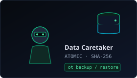<br /><sub><a href="./docs/10-operations-backup-and-upgrades.md">Backup &amp; Recovery</a></sub></td>
    <td align="center" width="25%">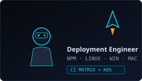<br /><sub><a href="./docs/11-testing-and-ci.md">CI Matrix &amp; Releases</a></sub></td>
  </tr>
</table>

---

## Architecture

<div align="center">
  
</div>

### Core Console Views (`01` - `06`)

| View | Name                   | Capabilities                                                                                                                                                                                                        |
| :--- | :--------------------- | :------------------------------------------------------------------------------------------------------------------------------------------------------------------------------------------------------------------ |
| `01` | **Cluster Overview**   | Honest disconnected setup state when unlinked; 4-column Prometheus telemetry strip (`CPU`, `Memory`, `Network Mbps`, `P99 Latency`); multi-window SVG charts (`15m`, `1h`, `6h`, `24h`); live node readiness table. |
| `02` | **Nodes & Workloads**  | Node & Pod search/filtering; Deployment scale (`0..200`) and rollout restart; Node `Cordon`/`Uncordon`, PDB-checked `Drain`, and `Delete Pod` guarded by confirmation modals and RBAC.                              |
| `03` | **Container Logs**     | Namespace, pod, container, and tail-line retrieval; live `/ws/logs` WebSocket stream; RegExp filtering and `.log` download.                                                                                         |
| `04` | **Services & Ingress** | Live `Service` & `Ingress` routing table with interactive SVG topology graph and inspection drawer.                                                                                                                 |
| `05` | **Incidents & PromQL** | Correlates Prometheus alert rules, Warning Kubernetes events, and crashing workloads; persistent triage overlays; interactive PromQL query runner.                                                                  |
| `06` | **Audit Trail**        | Searchable `audit.jsonl` operational ledger capturing logins, rate-limit lockouts, RBAC denials, WebSocket openings, and cluster writes.                                                                            |

---

## Persistent Storage

Obsidian Telemetry stores persistent configuration, `scrypt` credentials, triage state, logs, and audit history in platform-standard user directories (overridable via `OT_HOME`):

| Platform    | Config & Credentials (`0600` POSIX)                       | State, Audit, PID & Rotated Logs                   |
| :---------- | :-------------------------------------------------------- | :------------------------------------------------- |
| **Linux**   | `~/.config/obsidian-telemetry`                            | `~/.local/share/obsidian-telemetry`                |
| **macOS**   | `~/Library/Application Support/Obsidian Telemetry/config` | `~/Library/Application Support/Obsidian Telemetry` |
| **Windows** | `%APPDATA%\Obsidian Telemetry`                            | `%LOCALAPPDATA%\Obsidian Telemetry`                |

<div align="center">
  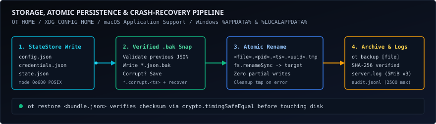
</div>

All JSON mutations use UUID-nonced atomic temp-rename writes (`<file>.<pid>.<ts>.<uuid>.tmp`), preserve validated `.bak` snapshots, quarantine unreadable payloads to `*.corrupt.<ts>`, and rotate `logs/server.log` at `5 MiB`.

---

## Security Model

<div align="center">
  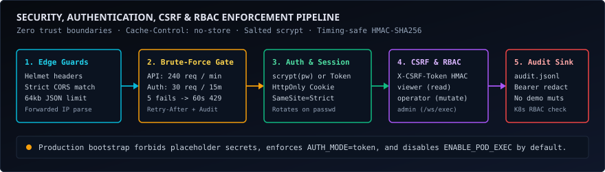
</div>

- **Secure by Default**: `ot` and `NODE_ENV=production` default to `AUTH_MODE=token`, generate a salted `scrypt` password for `admin`, forbid placeholder `SESSION_SECRET` / `OBSIDIAN_*_TOKEN` strings in production, and emit `Cache-Control: no-store` on every `/api/*` response.
- **Brute-Force & Session Defense**: `/api/auth/login` and `/api/auth/password` enforce both a sliding IP window (`30 req / 15m`) and per-`IP:actor` failure lockouts (`5` failures -> `60s` HTTP `429` + `Retry-After`). Password updates immediately rotate both the `HttpOnly`, `SameSite=Strict` HMAC cookie and `X-CSRF-Token`.
- **Execution Guardrails**: `ENABLE_POD_EXEC` is `false` by default, Demo Mode blocks all cluster mutations (`400 Bad Request`), and Kubernetes errors strip any `Bearer <token>` substrings before logging or returning responses.

---

## Deployment

### Source Build & Local Development

```bash
git clone https://github.com/devlopergit04/Obsidian-Telemetry.git
cd Obsidian-Telemetry
npm install
npm run dev     # Vite HMR-free preview + Express dev server
# or production build & CLI:
npm run build
node dist-server/src/cli/ot.js
```

### Docker Compose (App + Prometheus)

```bash
SESSION_SECRET="$(openssl rand -hex 32)" docker compose up -d --build
```

Requires an explicit 32+ character `SESSION_SECRET` (zero hardcoded fallback secrets) and defaults `KUBE_MODE=disabled` until a kubeconfig volume is intentionally mounted.

### Kubernetes In-Cluster Deployment

```bash
kubectl create namespace observability
kubectl create secret generic obsidian-telemetry-secrets \
  -n observability \
  --from-literal=session-secret="$(openssl rand -hex 32)" \
  --from-literal=admin-token="$(openssl rand -hex 24)" \
  --from-literal=operator-token="$(openssl rand -hex 24)"

kubectl apply -f deploy/kubernetes/pvc.yaml
kubectl apply -f deploy/kubernetes/rbac.yaml           # Read-only viewer permissions by default
# kubectl apply -f deploy/kubernetes/rbac-operator.yaml  # Opt-in node/pod/deployment mutations
kubectl apply -f deploy/kubernetes/deployment.yaml
```

---

## Complete Documentation Book

| Chapter | Guide                                                                                  | Key Topics                                                                 |
| :------ | :------------------------------------------------------------------------------------- | :------------------------------------------------------------------------- |
| **01**  | [Introduction & Quick Start](./docs/01-introduction-and-quickstart.md)                 | Philosophy, requirements, npm / `install.sh` / `install.ps1`               |
| **02**  | [CLI Reference & Network Binding](./docs/02-cli-and-networking.md)                     | `ot` commands, flags, `0.0.0.0:1392`, SSH tunnels & LAN access             |
| **03**  | [Reverse Proxies, TLS & Autostart](./docs/03-reverse-proxy-tls-and-systemd.md)         | Nginx, Caddy, Apache, Traefik, systemd, launchd, Windows Task Scheduler    |
| **04**  | [Architecture & Tech Stack](./docs/04-architecture-and-stack.md)                       | Layer design, storage lifecycle, dependency rationale                      |
| **05**  | [Frontend Views & Controls](./docs/05-frontend-and-views.md)                           | Views `01`–`06`, AuthModal, CommandPalette, Drawers                        |
| **06**  | [Configuration, Auth & Security](./docs/06-authentication-security-and-rbac.md)        | All env vars, directories, `scrypt`, HMAC, CSRF, RBAC, hardening checklist |
| **07**  | [Kubernetes & Prometheus](./docs/07-kubernetes-and-prometheus.md)                      | `KUBE_MODE` strategies, timeouts, PDB drain, PromQL queries                |
| **08**  | [REST API & WebSocket Protocol](./docs/08-api-and-websockets.md)                       | All routes, Zod schemas, `/ws/logs`, `/ws/exec` framing                    |
| **09**  | [Docker & Kubernetes Manifests](./docs/09-deployment-containers-and-k8s.md)            | Compose security, PVC, split viewer/operator RBAC                          |
| **10**  | [Backup, Restore, Upgrades & Uninstall](./docs/10-operations-backup-and-upgrades.md)   | `ot backup`, `ot restore`, `ot update`, `ot passwd`, `ot uninstall`        |
| **11**  | [Testing, CI/CD Matrix & Code Standards](./docs/11-testing-and-ci.md)                  | Unit/API/UI suites, multi-OS GitHub Actions matrix, release workflow       |
| **12**  | [Limits, Troubleshooting & FAQ](./docs/12-limitations-troubleshooting-and-faq.md)      | Scaling bounds, metrics-server, common errors, FAQ                         |
| **13**  | [Contributing, Governance & Roadmap](./docs/13-governance-contributing-and-roadmap.md) | PR checklist, disclosure policy, MIT license, `CHANGELOG`, roadmap         |

---

## Testing

<div align="center">
  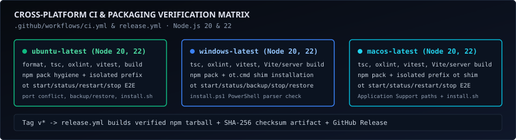
</div>

```bash
npm run format:check  # Prettier formatting check
npm run lint          # TypeScript strict type-check (tsc --noEmit)
npm run lint:code     # Oxlint static analysis (--deny-warnings)
npm test              # Vitest unit, API integration, persistence, and UI suites
npm run build         # Production Vite client + compiled dist-server backend & CLI
```

---

## Contributing & License

Obsidian Telemetry is free, open-source software released under the [MIT License](./LICENSE).

- [CONTRIBUTING.md](./CONTRIBUTING.md)
- [CODE_OF_CONDUCT.md](./CODE_OF_CONDUCT.md)
- [SECURITY.md](./SECURITY.md)
- [CHANGELOG.md](./CHANGELOG.md)
