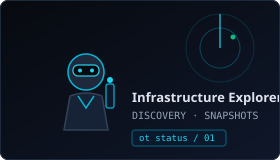

# Chapter 01 — Introduction, Philosophy, Requirements & Installation



[Docs Index](./README.md) · [Next: Chapter 02 — CLI & Network Binding](./02-cli-and-networking.md)

---

## 1. Introduction & Philosophy

**Obsidian Telemetry** is a self-hosted, cross-platform Kubernetes cluster observability and operations console packaged as a single npm CLI application (`obsidian-telemetry`) with the global executable `ot`.

The guiding design philosophy rests on four operational guarantees:

1. **Zero Hidden Dependencies**: Running `ot` launches an embedded Express + WebSocket + Vite-built React application directly on Node.js `>= 20.0.0`. No Docker daemon, external database server, or hosted SaaS control plane is required.
2. **Honest Telemetry Semantics**: When disconnected from Kubernetes or Prometheus, the API explicitly returns `sourceMode: "disconnected"` with empty resource arrays and `null` KPI metrics. Synthetic data is strictly opt-in (`mode=demo` when `ENABLE_DEMO_MODE=true`), clearly labeled `DEMO`, and blocked from all mutating endpoints.
3. **Secure by Default**: Production and `ot`-managed launches automatically set `AUTH_MODE=token`, generate a salted `scrypt` password hash for `admin` on first boot, store secrets with `0600` POSIX permissions, enforce `HttpOnly` + `SameSite=Strict` HMAC-SHA256 cookies, protect cookie mutations with `X-CSRF-Token`, and rate-limit brute-force login attempts.
4. **Least-Privilege Operations**: Interactive pod shell (`/ws/exec`) is disabled by default (`ENABLE_POD_EXEC=false`), Kubernetes RBAC manifests split read-only observability (`deploy/kubernetes/rbac.yaml`) from opt-in mutations (`deploy/kubernetes/rbac-operator.yaml`), and node drain validates `PodDisruptionBudget` and destination capacity constraints before pod eviction.

---

## 2. Why Obsidian Telemetry Exists

Engineering teams managing small-to-medium Kubernetes clusters, homelab infrastructure, air-gapped networks, or staging environments frequently face an awkward gap:

- `kubectl` + `k9s` excel in a terminal but provide no persistent browser-based audit log, team RBAC separation across viewer/operator/admin roles, or correlated Prometheus alerting + YAML inspection UI.
- Full enterprise observability stacks require multiple StatefulSets, ingress controllers, external OIDC providers, and substantial RAM before an operator can even list pod restarts.

Obsidian Telemetry bridges that gap with a **single-command self-hosted control plane** (`npm install -g obsidian-telemetry && ot`) that fits cleanly on a single VPS, laptop, bastion host, Docker Compose stack, or in-cluster Pod.

---

## 3. System Requirements

| Component          | Minimum          | Recommended                                                  | Notes                                                                                            |
| :----------------- | :--------------- | :----------------------------------------------------------- | :----------------------------------------------------------------------------------------------- |
| **Node.js**        | `>= 20.0.0`      | `20 LTS` or `22 LTS`                                         | Checked by `package.json` `engines`, `install.sh`, and `install.ps1`                             |
| **npm**            | `>= 9.0.0`       | `>= 10.0.0`                                                  | Bundled with Node.js; used by `ot update`                                                        |
| **RAM**            | `128 MiB`        | `256–512 MiB`                                                | Matches `deploy/kubernetes/deployment.yaml` limits (`512Mi`)                                     |
| **Disk**           | `80 MiB`         | `500 MiB+`                                                   | Stores package bundle, `state.json`, `audit.jsonl`, `.bak` snapshots, and rotated `server.log.*` |
| **Network Port**   | TCP `1392`       | TCP `1392` (or reverse-proxied `443`)                        | Configurable via `OT_PORT` or `ot --port <port>`                                                 |
| **Cluster Access** | Optional at boot | Kubeconfig / In-Cluster SA / API Token + Prometheus HTTP URL | Starts cleanly disconnected for verification or demo mode                                        |

---

## 4. Quick Start

Pick the workflow that matches your environment:

### 4.1 One-Command Global CLI (Bare Metal / VM / Bastion / Workstation)

```bash
npm install -g obsidian-telemetry
ot
```

Open `http://localhost:1392` (or `http://SERVER-IP:1392` over LAN/VPN) and sign in with username `admin` and the one-time initial password printed to stdout.

### 4.2 Local Source Execution (Contributors & Air-Gapped Builds)

```bash
git clone https://github.com/devlopergit04/Obsidian-Telemetry.git
cd Obsidian-Telemetry
npm install
npm run build
node dist-server/src/cli/ot.js
```

### 4.3 Docker Compose (App + Local Prometheus)

```bash
export SESSION_SECRET="$(openssl rand -hex 32)"
docker compose up -d --build
```

Access the dashboard at `http://localhost:1392` and Prometheus at `http://localhost:9090`.

### 4.4 In-Cluster Kubernetes Deployment

```bash
kubectl create namespace observability
kubectl create secret generic obsidian-telemetry-secrets \
  -n observability \
  --from-literal=session-secret="$(openssl rand -hex 32)" \
  --from-literal=admin-token="$(openssl rand -hex 24)" \
  --from-literal=operator-token="$(openssl rand -hex 24)"

kubectl apply -f deploy/kubernetes/pvc.yaml
kubectl apply -f deploy/kubernetes/rbac.yaml
kubectl apply -f deploy/kubernetes/deployment.yaml
```

---

## 5. Supported Platforms

Obsidian Telemetry adapts filesystem paths, process signals, npm executable wrappers, and file-locking safety across all three major desktop/server operating systems:

| Operating System         | Architectures                          | Verified Path Strategy                                                                   | Wrapper / Launcher                                                   |
| :----------------------- | :------------------------------------- | :--------------------------------------------------------------------------------------- | :------------------------------------------------------------------- |
| **Linux**                | `x64`, `arm64`, `armv7`                | XDG Base Directory (`~/.config/obsidian-telemetry`, `~/.local/share/obsidian-telemetry`) | `~/.local/bin/ot` or global npm `bin/ot`                             |
| **macOS**                | `arm64` (Apple Silicon), `x64` (Intel) | `~/Library/Application Support/Obsidian Telemetry/{config,}`                             | `~/.local/bin/ot` or global npm `bin/ot`                             |
| **Windows 10/11/Server** | `x64`, `arm64`                         | `%APPDATA%\Obsidian Telemetry` and `%LOCALAPPDATA%\Obsidian Telemetry`                   | `%LOCALAPPDATA%\ObsidianTelemetry\npm\ot.cmd` or global npm `ot.cmd` |

Note: Pure Node.js server and React frontend code contains zero native C++ addons, eliminating node-gyp compilation failures across architectures.

---

## 6. Installation via npm

Installing globally from npm is the recommended cross-platform method:

```bash
npm install -g obsidian-telemetry
```

### Verifying Global Installation

```bash
which ot          # Linux / macOS
where.exe ot      # Windows PowerShell / CMD
ot --version
```

### Isolated Non-Root Prefix (Optional)

If your system restricts global writes to `/usr/local/lib/node_modules`:

```bash
mkdir -p ~/.npm-global
npm config set prefix ~/.npm-global
export PATH="$HOME/.npm-global/bin:$PATH"
npm install -g obsidian-telemetry
ot --version
```

---

## 7. Installation via `install.sh` (Linux/macOS) & `install.ps1` (Windows)

### 7.1 Linux & macOS (`install.sh`)

```bash
curl -fsSL https://raw.githubusercontent.com/devlopergit04/Obsidian-Telemetry/main/install.sh | sh
```

**What `install.sh` actually executes (auditable behavior):**

1. Detects `uname -s` (`Linux` or `Darwin`) and `uname -m` (`x86_64`/`amd64`, `aarch64`/`arm64`, etc.).
2. Verifies `node` and `npm` exist and checks Node major version `>= 20`. If missing, exits non-zero with OS-specific instructions (`apt`, `dnf`, `brew`).
3. Installs `obsidian-telemetry@${OT_VERSION:-latest}` into user-scoped prefix `$HOME/.local/share/obsidian-telemetry/npm` (no `sudo`, no modifications to `/usr/bin` or `/etc`).
4. Links `$HOME/.local/bin/ot -> $PREFIX/bin/ot` (overridable via `OT_BIN_DIR`).
5. Runs `"$BIN_DIR/ot" --version` to verify the executable works immediately and warns if `PATH` lacks `$BIN_DIR`.

Supports custom overrides:

- `OT_NPM_SPEC` — install a specific version or local `.tgz` tarball during offline/staging verification.
- `OT_INSTALL_PREFIX` — override `~/.local/share/obsidian-telemetry/npm`.
- `OT_BIN_DIR` — override `~/.local/bin`.

### 7.2 Windows PowerShell (`install.ps1`)

> POSIX `curl | sh` scripts do **not** run natively in Windows CMD or PowerShell. Always use `install.ps1` on Windows.

```powershell
irm https://raw.githubusercontent.com/devlopergit04/Obsidian-Telemetry/main/install.ps1 | iex
```

Or inspect locally before execution:

```powershell
Invoke-WebRequest -Uri https://raw.githubusercontent.com/devlopergit04/Obsidian-Telemetry/main/install.ps1 -OutFile install.ps1
Get-Content .\install.ps1
.\install.ps1
```

**What `install.ps1` performs:**

1. Enforces `$ErrorActionPreference = 'Stop'` and checks Windows architecture (`PROCESSOR_ARCHITECTURE`).
2. Verifies `node` (`>= 20`) and `npm.cmd` availability.
3. Installs `obsidian-telemetry` into `%LOCALAPPDATA%\ObsidianTelemetry\npm`.
4. Prepends the prefix directory (`ot.cmd`) to User `PATH` via `[Environment]::SetEnvironmentVariable(..., 'User')` only if not already present, and updates the active session `$env:Path`.
5. Executes `& "$InstallPrefix\ot.cmd" --version` to verify installation.

---

[Docs Index](./README.md) · [Next: Chapter 02 — CLI & Network Binding](./02-cli-and-networking.md)
