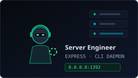

# Chapter 02 — CLI Command Reference & Network Binding



[Previous: Chapter 01 — Introduction & Quick Start](./01-introduction-and-quickstart.md) · [Docs Index](./README.md) · [Next: Chapter 03 — Reverse Proxy, TLS & Autostart](./03-reverse-proxy-tls-and-systemd.md)

---

## 8. CLI Command Reference (`ot`)

The binary entrypoint compiled from `src/cli/ot.ts` to `dist-server/src/cli/ot.js` provides full lifecycle management without requiring an external process supervisor for interactive/single-host operation.

```text
Usage:
  ot [command] [options]
```

### 8.1 Subcommands

| Command           | Arguments                          | Execution Behavior                                                                                                                                                                                                                                                                                                                                                  |
| :---------------- | :--------------------------------- | :------------------------------------------------------------------------------------------------------------------------------------------------------------------------------------------------------------------------------------------------------------------------------------------------------------------------------------------------------------------ |
| `ot` / `ot start` | `[--host] [--port] [--foreground]` | Defaults to `NODE_ENV=production`, `AUTH_MODE=token`, `OT_MANAGED=1`. Verifies no existing instance owns the PID/port, rotates `logs/server.log` if `>= 5 MiB`, spawns detached Node server daemon (`windowsHide: true`), polls `/api/health` up to 12 seconds, and prints the running banner + one-time `admin` password on first boot.                            |
| `ot stop`         | none                               | Reads `obsidian.pid`. If stale PID metadata remains from a crash, clears it cleanly. Otherwise sends `SIGTERM`, polls up to 8 seconds for graceful socket draining (`server.close()`), escalates to `SIGKILL` only if hung, and removes `obsidian.pid`.                                                                                                             |
| `ot restart`      | `[--host] [--port] [--foreground]` | Executes `cmdStop()` followed by `cmdStart()`.                                                                                                                                                                                                                                                                                                                      |
| `ot status`       | none                               | Checks PID file liveness and probes `http://127.0.0.1:<port>/api/health` (`service === 'obsidian-telemetry'`). Prints PID, bound host, port, reachable URLs, and auth mode (`0` exit code), or prints `Status: Stopped` (`1` exit code).                                                                                                                            |
| `ot update`       | `[--host] [--port]`                | Detects whether the daemon is currently running, **stops it cleanly before file replacement** (preventing Windows `EBUSY`/`EPERM` executable locks), invokes `npm install -g <spec>` targeting the detected install prefix (`OT_NPM_SPEC` / `OT_INSTALL_PREFIX` supported), rolls back startup if the npm install fails, and restarts if it was previously running. |
| `ot backup`       | `[output-file.json]`               | Exports `config.json`, `credentials.json`, `state.json`, and `audit.jsonl` into a canonical JSON bundle (`format: "obsidian-telemetry-backup"`) stamped with a SHA-256 checksum over the payload and written atomically with mode `0o600`.                                                                                                                          |
| `ot restore`      | `<backup-file.json>`               | Validates bundle structure and compares payload SHA-256 digest via `crypto.timingSafeEqual` **before** modifying any state file. Stops a running service cleanly during restore, writes updated `.bak` snapshots before overwriting primary files, and restarts if previously running.                                                                              |
| `ot passwd`       | `[username] [--password <pw>]`     | Updates or creates a local user credential (`default: admin`) using a freshly salted 64-byte `scrypt` digest in `credentials.json`. Enforces minimum 8-character password length and prompts interactively when `--password` is omitted in a TTY.                                                                                                                   |
| `ot uninstall`    | `[--yes]`                          | Prompts for confirmation in a TTY (or requires `--yes` / `-y` in non-interactive shells), stops the running service, removes `configDir`, `dataDir`, empty `OT_HOME`, user-local `~/.local/bin/ot` symlink if pointing to Obsidian Telemetry, and uninstalls the global npm package when installed under a standard prefix.                                         |

### 8.2 Flags & Options

| Flag              | Short | Description                                                                                                                                  |
| :---------------- | :---- | :------------------------------------------------------------------------------------------------------------------------------------------- |
| `--port <port>`   | `-p`  | Override HTTP/WebSocket listening port (`1..65535`). Overrides `OT_PORT` and `config.json`.                                                  |
| `--host <host>`   | `-H`  | Override bind interface (e.g., `127.0.0.1`, `0.0.0.0`, `::`).                                                                                |
| `--foreground`    | `-f`  | Attach `stdio: 'inherit'` to the current terminal instead of spawning a detached background daemon. Ideal for systemd, Docker, or debugging. |
| `--yes`           | `-y`  | Skip interactive confirmation prompts for `ot uninstall`.                                                                                    |
| `--password <pw>` | none  | Supply password non-interactively for `ot passwd` (for scripted provisioning).                                                               |
| `--version`       | `-v`  | Print `<name> v<version>` from `package.json`.                                                                                               |
| `--help`          | `-h`  | Print CLI usage summary.                                                                                                                     |

### 8.3 Exit Codes & Fail-Fast Port Conflict Policy

When another process already occupies the target port (`EADDRINUSE`) and does **not** respond with `service === "obsidian-telemetry"` on `/api/health`:

- `ot` **fails fast with exit code `1`** and an explicit error naming the conflicting host/port and remediation flags (`OT_PORT=<port>` / `--port <port>`).
- `ot` **never** silently jumps to a random fallback port, preventing automation scripts, reverse proxies, and firewall rules from breaking unexpectedly.

---

## 9. Port, Host & Network Binding (`0.0.0.0:1392`)

Obsidian Telemetry binds by default to:

- **Host**: `0.0.0.0` (all IPv4 interfaces on the host)
- **Port**: `1392`
- **Protocol**: HTTP/1.1 + RFC 6455 WebSocket upgrade on the same socket

### Precedence Order for Host & Port Resolution

1. CLI flags (`--host`, `--port`)
2. `OT_HOST` / `OT_PORT` environment variables
3. Legacy `HOST` / `PORT` environment variables (note: CLI `buildCliEnv` strips ambient `PORT` so random shell `PORT` variables like `PORT=3000` do not hijack `ot`'s default `1392`)
4. Persisted `config.json` values (`host`, `port`)
5. Built-in defaults (`0.0.0.0` and `1392`)

### Inspecting Live Socket Binding

```bash
# Linux
ss -tlnp | grep 1392

# macOS
lsof -nP -iTCP:1392 -sTCP:LISTEN

# Windows PowerShell
Get-NetTCPConnection -LocalPort 1392 -State Listen
```

---

## 10. Accessing from Localhost, LAN & Remote Servers

### 10.1 Local Workstation (`http://localhost:1392`)

When running on your local machine, open `http://localhost:1392` or `http://127.0.0.1:1392`. Session cookies work cleanly over HTTP without requiring TLS because `server/app.ts` sets `secure: req.secure || req.headers['x-forwarded-proto'] === 'https'`.

### 10.2 LAN or Private Network (`http://SERVER-IP:1392`)

Because `ot` binds to `0.0.0.0:1392`, any host on the same LAN, WireGuard mesh, or Tailscale network can reach `http://<LAN-IP>:1392`. Ensure host firewalls permit TCP `1392`:

```bash
# Ubuntu / Debian UFW (restrict to LAN subnet where possible)
sudo ufw allow from 192.168.1.0/24 to any port 1392 proto tcp

# firewalld (RHEL / Fedora / Rocky)
sudo firewall-cmd --add-port=1392/tcp --permanent
sudo firewall-cmd --reload
```

### 10.3 Public VPS & SSH Port Forwarding (Recommended Without Reverse Proxy)

If exposing directly on a public VPS is undesirable, bind Obsidian Telemetry strictly to loopback and tunnel via SSH:

```bash
# On remote server:
ot start --host 127.0.0.1 --port 1392

# On operator workstation:
ssh -N -L 1392:127.0.0.1:1392 user@remote-server
```

Then browse `http://localhost:1392` over an encrypted SSH tunnel without opening TCP `1392` to the public internet. For permanent HTTPS domain access, configure a TLS-terminating reverse proxy as detailed in [Chapter 03](./03-reverse-proxy-tls-and-systemd.md).

---

[Previous: Chapter 01 — Introduction & Quick Start](./01-introduction-and-quickstart.md) · [Docs Index](./README.md) · [Next: Chapter 03 — Reverse Proxy, TLS & Autostart](./03-reverse-proxy-tls-and-systemd.md)
