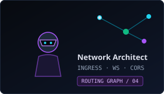

# Chapter 03 — Reverse Proxies, TLS & OS Service Managers



[Previous: Chapter 02 — CLI & Network Binding](./02-cli-and-networking.md) · [Docs Index](./README.md) · [Next: Chapter 04 — Architecture & Technology Stack](./04-architecture-and-stack.md)

---

## 11. Reverse Proxy Setup with TLS & WebSocket Support

When exposing Obsidian Telemetry across untrusted networks or corporate VPNs, place it behind a TLS-terminating reverse proxy bound to `127.0.0.1:1392`.

Two application behaviors are critical when proxying:

1. **Trusted Proxy Headers**: `src/server/app.ts` enables `app.set('trust proxy', 1)` and inspects both `X-Forwarded-For` and RFC 7239 `Forwarded` headers for accurate rate limiting, plus `X-Forwarded-Proto: https` to automatically apply the `Secure` attribute on `obsidian_session` cookies.
2. **CORS & WebSocket Origin Alignment**: Set `CORS_ORIGIN=https://telemetry.example.com` (or match the exact forwarded `Host` header) so browser `Origin` checks pass on `/api/*` requests and `/ws/logs` / `/ws/exec` WebSocket upgrades.

### 11.1 Nginx

```nginx
map $http_upgrade $connection_upgrade {
    default upgrade;
    ''      close;
}

server {
    listen 443 ssl http2;
    server_name telemetry.example.com;

    ssl_certificate     /etc/letsencrypt/live/telemetry.example.com/fullchain.pem;
    ssl_certificate_key /etc/letsencrypt/live/telemetry.example.com/privkey.pem;

    location / {
        proxy_pass http://127.0.0.1:1392;
        proxy_http_version 1.1;

        proxy_set_header Host              $host;
        proxy_set_header X-Real-IP         $remote_addr;
        proxy_set_header X-Forwarded-For   $proxy_add_x_forwarded_for;
        proxy_set_header X-Forwarded-Proto $scheme;

        # Required for /ws/logs and /ws/exec
        proxy_set_header Upgrade           $http_upgrade;
        proxy_set_header Connection        $connection_upgrade;
        proxy_read_timeout 3600s;
    }
}
```

### 11.2 Caddy (Automatic Let's Encrypt HTTPS)

```caddyfile
telemetry.example.com {
    reverse_proxy 127.0.0.1:1392
}
```

Caddy natively passes WebSocket upgrades, `X-Forwarded-For`, `X-Forwarded-Proto`, and `Host` automatically.

### 11.3 Apache HTTP Server (`mod_proxy` + `mod_proxy_wstunnel`)

```apache
<VirtualHost *:443>
    ServerName telemetry.example.com

    SSLEngine on
    SSLCertificateFile    /etc/letsencrypt/live/telemetry.example.com/fullchain.pem
    SSLCertificateKeyFile /etc/letsencrypt/live/telemetry.example.com/privkey.pem

    ProxyPreserveHost On
    RequestHeader set X-Forwarded-Proto "https"

    RewriteEngine On
    RewriteCond %{HTTP:Upgrade} websocket [NC]
    RewriteCond %{HTTP:Connection} upgrade [NC]
    RewriteRule ^/?(.*) "ws://127.0.0.1:1392/$1" [P,L]

    ProxyPass        / http://127.0.0.1:1392/
    ProxyPassReverse / http://127.0.0.1:1392/
</VirtualHost>
```

### 11.4 Traefik v3 Dynamic Label Example

```yaml
labels:
  - 'traefik.enable=true'
  - 'traefik.http.routers.obsidian.rule=Host(`telemetry.example.com`)'
  - 'traefik.http.routers.obsidian.entrypoints=websecure'
  - 'traefik.http.routers.obsidian.tls.certresolver=letsencrypt'
  - 'traefik.http.services.obsidian.loadbalancer.server.port=1392'
```

---

## 12. Process Management & Autostart Across Operating Systems

While `ot start` manages a standalone daemon cleanly during interactive sessions, production servers reboot automatically. Always run `ot --foreground` under an OS service supervisor so the supervisor tracks the process PID directly.

### 12.1 Linux `systemd` Unit (User or System Service)

System-wide service `/etc/systemd/system/obsidian-telemetry.service`:

```ini
[Unit]
Description=Obsidian Telemetry Observability Server
After=network-online.target
Wants=network-online.target

[Service]
Type=simple
User=obsidian
Group=obsidian
Environment=NODE_ENV=production
Environment=OT_HOST=127.0.0.1
Environment=OT_PORT=1392
Environment=OT_HOME=/var/lib/obsidian-telemetry
EnvironmentFile=-/etc/obsidian-telemetry/env
ExecStart=/usr/bin/env ot start --foreground --host 127.0.0.1 --port 1392
Restart=on-failure
RestartSec=5
NoNewPrivileges=true
PrivateTmp=true
ProtectSystem=strict
ReadWritePaths=/var/lib/obsidian-telemetry

[Install]
WantedBy=multi-user.target
```

Enable and monitor:

```bash
sudo systemctl daemon-reload
sudo systemctl enable --now obsidian-telemetry
sudo journalctl -u obsidian-telemetry -f
```

### 12.2 macOS `launchd` LaunchAgent

Save to `~/Library/LaunchAgents/io.obsidiantelemetry.server.plist`:

```xml
<?xml version="1.0" encoding="UTF-8"?>
<!DOCTYPE plist PUBLIC "-//Apple//DTD PLIST 1.0//EN" "http://www.apple.com/DTDs/PropertyList-1.0.dtd">
<plist version="1.0">
<dict>
  <key>Label</key>
  <string>io.obsidiantelemetry.server</string>
  <key>ProgramArguments</key>
  <array>
    <string>/usr/local/bin/ot</string>
    <string>start</string>
    <string>--foreground</string>
  </array>
  <key>EnvironmentVariables</key>
  <dict>
    <key>NODE_ENV</key>
    <string>production</string>
    <key>OT_PORT</key>
    <string>1392</string>
  </dict>
  <key>RunAtLoad</key>
  <true/>
  <key>KeepAlive</key>
  <true/>
  <key>StandardOutPath</key>
  <string>/tmp/obsidian-telemetry.out.log</string>
  <key>StandardErrorPath</key>
  <string>/tmp/obsidian-telemetry.err.log</string>
</dict>
</plist>
```

Load with `launchctl load -w ~/Library/LaunchAgents/io.obsidiantelemetry.server.plist`.

### 12.3 Windows Task Scheduler (PowerShell Setup)

Register a background task running at system startup or user logon:

```powershell
$OtExe = (Get-Command ot.cmd).Source
$Action = New-ScheduledTaskAction -Execute $OtExe -Argument "start --foreground"
$Trigger = New-ScheduledTaskTrigger -AtLogOn
$Settings = New-ScheduledTaskSettingsSet -AllowStartIfOnBatteries -DontStopIfGoingOnBatteries -ExecutionTimeLimit ([TimeSpan]::Zero)
Register-ScheduledTask -TaskName "ObsidianTelemetry" -Action $Action -Trigger $Trigger -Settings $Settings -Description "Obsidian Telemetry Self-Hosted Server"
Start-ScheduledTask -TaskName "ObsidianTelemetry"
```

---

[Previous: Chapter 02 — CLI & Network Binding](./02-cli-and-networking.md) · [Docs Index](./README.md) · [Next: Chapter 04 — Architecture & Technology Stack](./04-architecture-and-stack.md)
