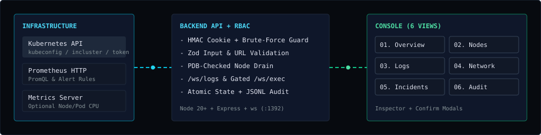
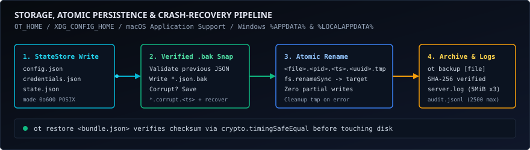

# Chapter 04 — System Architecture & Technology Stack

[Previous: Chapter 03 — Reverse Proxy, TLS & Autostart](./03-reverse-proxy-tls-and-systemd.md) · [Docs Index](./README.md) · [Next: Chapter 05 — Frontend Views & Controls](./05-frontend-and-views.md)

---

## 13. Architecture Overview

Obsidian Telemetry follows a strict modular boundary between CLI process orchestration, HTTP/WebSocket control plane, cluster adapters, local persistence, and the React dashboard client.

  

### 13.1 Execution Layers

| Layer                 | Key Modules                                                                                           | Responsibility                                                                                                                                                                                                                                                            |
| :-------------------- | :---------------------------------------------------------------------------------------------------- | :------------------------------------------------------------------------------------------------------------------------------------------------------------------------------------------------------------------------------------------------------------------------ |
| **CLI Layer**         | `src/cli/ot.ts`                                                                                       | Cross-platform command dispatch (`start`, `stop`, `restart`, `status`, `update`, `uninstall`, `backup`, `restore`, `passwd`), port conflict checks, background daemon spawning, log rotation, and PID tracking.                                                           |
| **HTTP Bootstrap**    | `server.ts`                                                                                           | Resolves CLI/env config, initializes services, mounts Express app + `ws` upgrade hub on a single `http.Server`, serves Vite middleware in dev (`NODE_ENV !== 'production'`) or static `dist/` SPA bundle in production, and handles `SIGINT`/`SIGTERM` graceful shutdown. |
| **API & Security**    | `src/server/app.ts`, `src/server/middleware/auth.ts`                                                  | Helmet headers, dynamic same-host / explicit CORS, `64kb` JSON cap, dual rate limiters, per-actor/IP brute-force lockout, HMAC-SHA256 `HttpOnly` cookie sessions, timing-safe static tokens, `X-CSRF-Token` verification, and Zod validation.                             |
| **Cluster & Metrics** | `src/server/services/kubernetesService.ts`, `prometheusService.ts`                                    | Multi-context `@kubernetes/client-node` v2 connector (`SelfSubjectAccessReview`, 10s timeouts, PDB drain guards) + real Prometheus `/api/v1/*` PromQL client.                                                                                                             |
| **WebSocket Hub**     | `src/server/services/wsHub.ts`                                                                        | Origin-verified, RBAC-gated upgrade router for streaming pod logs (`/ws/logs`) and policy-gated interactive pod shells (`/ws/exec`).                                                                                                                                      |
| **Persistence**       | `src/server/platform.ts`, `src/server/services/stateStore.ts`, `auditLogger.ts`, `incidentService.ts` | Cross-platform XDG/macOS/Windows paths, atomic temp-rename writes with UUID nonces, `.bak` pre-write snapshots, `.corrupt.<ts>` quarantine, append-only `audit.jsonl`, and SHA-256 backup/restore.                                                                        |
| **Demo Isolation**    | `src/server/services/demoProvider.ts`                                                                 | Isolated synthetic fixtures served ONLY when `ENABLE_DEMO_MODE=true` and `?mode=demo` is explicitly requested; completely decoupled from live cluster snapshots and blocked on all mutating endpoints.                                                                    |
| **Frontend Client**   | `src/App.tsx`, `src/api/client.ts`, `src/components/*`                                                | React 19 TypeScript SPA using Cookie `credentials: 'include'`, automatic in-memory `X-CSRF-Token` management, 6 core observability screens, modals, command palette (`⌘K`/`Ctrl+K`), and responsive slide-over drawer.                                                    |

### 13.2 Persistence & Crash-Recovery Pipeline

  

1. Every write to `config.json`, `credentials.json`, and `state.json` validates the prior file's JSON syntax and atomically preserves it as `<file>.bak` before writing the update.
2. Atomic writes create `<file>.<pid>.<timestamp>.<uuid8>.tmp`, flush UTF-8 contents with mode `0o600`, rename over the target path, and delete orphaned temp files on error.
3. On read, if a primary file fails JSON parsing (e.g., power loss or external edit), `StateStore` quarantines the damaged payload to `<file>.corrupt.<timestamp>` and automatically recovers from `<file>.bak`.

---

## 14. Technology Stack & Dependency Rationale

| Package                                           | Category         | Purpose & Selection Rationale                                                                                                                               |
| :------------------------------------------------ | :--------------- | :---------------------------------------------------------------------------------------------------------------------------------------------------------- |
| `express` (`4.21.2`)                              | HTTP Server      | Mature, predictable middleware pipeline for REST API, static SPA serving, and reverse-proxy header support.                                                 |
| `@kubernetes/client-node` (`^2.0.2`)              | Kubernetes SDK   | Official CNCF TypeScript Kubernetes client supporting kubeconfig, in-cluster ServiceAccounts, raw bearer tokens, logs, exec, and `SelfSubjectAccessReview`. |
| `ws` (`^8.23.0`)                                  | WebSockets       | Lightweight, RFC-compliant WebSocket server attached cleanly via `noServer: true` to perform Origin + Auth checks before upgrading.                         |
| `helmet` & `cors`                                 | HTTP Security    | Defensive security headers and strict origin matching across local/LAN/reverse-proxy deployments.                                                           |
| `express-rate-limit`                              | Abuse Protection | Protects general `/api/*` throughput and tightens `/api/auth/login` + `/api/auth/password` endpoints while supporting RFC 7239 `Forwarded` headers.         |
| `zod` (`^4.6.7`)                                  | Validation       | Runtime schema validation for environment variables, Kubernetes resource names, replica bounds, PromQL payloads, and auth inputs.                           |
| `dotenv` (`^17.2.3`)                              | Configuration    | Loads `.env` overrides safely without overriding explicit process environment variables.                                                                    |
| `react` & `react-dom` (`^19.0.1`)                 | Frontend UI      | High-responsiveness component model with clean hooks and strict TypeScript typing.                                                                          |
| `tailwindcss` (`^4.3.3`)                          | Styling          | Utility-first dark telemetry surface system with tabular numerals (`tabular-nums`) and zero runtime CSS overhead.                                           |
| `lucide-react`                                    | Vector Icons     | Crisp uniform-stroke UI iconography with explicit `aria-label` accessibility attributes.                                                                    |
| `vitest` & `@testing-library/react` & `supertest` | Verification     | Fast TypeScript unit, Express HTTP integration, and JSDOM UI interaction testing.                                                                           |
| `oxlint` & `prettier` & `typescript`              | Code Quality     | Strict static analysis (`--deny-warnings`), consistent formatting, and dual client/server compilation (`tsconfig.json` + `tsconfig.server.json`).           |

---

[Previous: Chapter 03 — Reverse Proxy, TLS & Autostart](./03-reverse-proxy-tls-and-systemd.md) · [Docs Index](./README.md) · [Next: Chapter 05 — Frontend Views & Controls](./05-frontend-and-views.md)
