# Chapter 05 — Frontend Views & Interactive Controls

[Previous: Chapter 04 — Architecture & Technology Stack](./04-architecture-and-stack.md) · [Docs Index](./README.md) · [Next: Chapter 06 — Configuration, Auth & Security](./06-authentication-security-and-rbac.md)

---

## 15. Complete UI & Console Walkthrough (`01` – `06`)

  

Obsidian Telemetry's React 19 interface prioritizes operational clarity, keyboard efficiency, and truthful status states across six primary screens and four supporting global overlays.

### 15.1 Global Navigation & Overlays

- **TopBar (`src/components/TopBar.tsx`)**:
  - Active cluster context selector (`kubeconfig` contexts or explicitly labeled `Demo Cluster` when switched via `mode=demo`).
  - Live data source status indicator (`LIVE`, `DEMO`, or `DISCONNECTED`) with last-poll timestamp and manual refresh button.
  - Time window switcher (`15m`, `1h`, `6h`, `24h`) driving Prometheus `query_range` queries.
  - Authenticated session pill showing active actor (`admin`, `token-operator`, `anonymous-viewer`) and opening the **Session & RBAC Authentication Modal**.
  - Quick trigger for the **Command Palette** (`Cmd+K` / `Ctrl+K`).
- **SidebarRail (`src/components/SidebarRail.tsx`)**:
  - Collapsible navigation rail indexing views `01` through `06`, active incident badge count, and quick access to session status.
- **AuthModal (`src/components/AuthModal.tsx`)**:
  - Supports **Local Account Login** (`username` + `password`) and **Role Bearer Token Login** (`OBSIDIAN_*_TOKEN`).
  - Allows authenticated local users to rotate their own password in-place (`POST /api/auth/password`), updating both `scrypt` disk storage and rotating the active `HttpOnly` cookie + in-memory CSRF token seamlessly.
- **CommandPalette (`src/components/CommandPalette.tsx`)**:
  - Keyboard-accessible quick jumper across views `01`–`06`, nodes, pods, deployments, services, and refresh triggers.
- **TelemetryDrawer (`src/components/TelemetryDrawer.tsx`)**:
  - Slide-over contextual inspection panel showing pod conditions, container resource requests/limits, restarts, YAML manifest viewer button, pod deletion (RBAC gated), and quick jump to live container logs.
- **ConfirmActionModal & ResourceManifestModal**:
  - Destructive or cluster-mutating actions (`Cordon`, `Uncordon`, `Drain`, `Delete Pod`, `Restart Deployment`, `Scale Deployment`) require explicit modal confirmation naming the target resource and context.
  - `ResourceManifestModal` fetches sanitized live Kubernetes YAML manifests (`GET /api/manifests/:kind/:name`) with one-click copy and download.

### 15.2 Screen `01` — Cluster Overview (`OverviewScreen.tsx`)

- **Disconnected State**: When neither Kubernetes nor Prometheus is reachable, renders a clear setup checklist detailing `KUBE_MODE`, `PROMETHEUS_URL`, environment steps, and (when `ENABLE_DEMO_MODE=true`) an explicit button to inspect synthetic demo telemetry. Never fakes live metrics.
- **4-Column KPI Telemetry Strip**: Displays Cluster CPU `%`, Cluster Memory `%`, Network Throughput (`Mbps`), and HTTP `P99 Latency (ms)`—rendering `Unavailable` if Prometheus lacks a corresponding exporter metric.
- **Interactive SVG Time-Series Chart**: Multi-series time chart supporting hover scrubbing across `15m`, `1h`, `6h`, and `24h` windows.
- **Node Health Matrix & Recent Warnings**: Live node readiness table paired with cluster warning events.

### 15.3 Screen `02` — Nodes & Workloads (`NodesScreen.tsx`)

- Search input plus Namespace and Health Status filters (`HEALTHY`, `DEGRADED`, `CRASHED`, `CORDONED`).
- Expandable Node rows listing scheduled pods, CPU/memory allocations (`n/a` when `metrics-server` is absent), Pod restart counters, and condition pills.
- **Operator Actions** (enabled only when user holds `operator` or `admin` role AND Kubernetes `SelfSubjectAccessReview` reports permission AND mode is `live`):
  - **Node Cordon / Uncordon**: Toggles `spec.unschedulable`.
  - **Node Drain**: Queries `PodDisruptionBudget` selectors + available capacity on peer nodes before evicting evictable pods via `policy/v1` Eviction API.
  - **Deployment Scale & Rollout Restart**: Adjusts desired replica count (`0..200`) or patches `kubectl.kubernetes.io/restartedAt`.
  - **Delete Pod**: Terminates unhealthy or stuck pods cleanly.

### 15.4 Screen `03` — Container Logs (`LogsScreen.tsx`)

- Namespace, Pod, Container, and Tail-Line (`100` / `250` / `500`) selectors.
- One-shot snapshot retrieval (`GET /api/namespaces/:ns/pods/:pod/logs`) plus real-time live log streaming over `/ws/logs`.
- Dual **Substring / Regular Expression** filter with match counter and invalid-regex resilience, auto-scroll pause/resume toggle, and `.log` file export.

### 15.5 Screen `04` — Services & Ingress (`NetworkScreen.tsx`)

- Live inventory of Kubernetes `Service` (`ClusterIP`, `NodePort`, `LoadBalancer`) and `Ingress` resources (`host`, `path`, TLS status, backend port mapping).
- Interactive SVG routing topology graph highlighting Ingress-to-Service-to-Endpoint links and opening Service inspection details.

### 15.6 Screen `05` — Incidents & PromQL (`IncidentsScreen.tsx`)

- Aggregates three live signal classes into unified incident cards:
  1. Firing/pending Prometheus alerting rules (`/api/v1/rules`).
  2. Kubernetes `Warning` events.
  3. Unhealthy node conditions or crashing pods (`CrashLoopBackOff`, `OOMKilled`).
- Supports persistent operator **Acknowledge** and **Mark Triaged Locally** actions (`state.json`), clearly distinguished from underlying Kubernetes cluster healing.
- Embedded **PromQL Explorer** (`POST /api/prometheus/query`) with instant vector results and alerting rule definitions table.

### 15.7 Screen `06` — Audit Trail (`AuditScreen.tsx`)

- Real-time searchable table backed by `audit.jsonl` (`GET /api/audit?limit=100`).
- Captures actor ID, role, HTTP/WS/K8s action, target resource, cluster context, outcome (`succeeded`, `allowed`, `denied`, `failed`), client IP, and sanitized detail string.

---

[Previous: Chapter 04 — Architecture & Technology Stack](./04-architecture-and-stack.md) · [Docs Index](./README.md) · [Next: Chapter 06 — Configuration, Auth & Security](./06-authentication-security-and-rbac.md)
