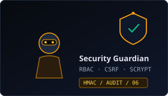
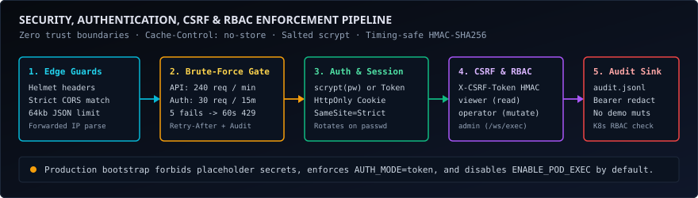

# Chapter 06 — Configuration, Authentication, RBAC & Security

[Previous: Chapter 05 — Frontend Views & Controls](./05-frontend-and-views.md) · [Docs Index](./README.md) · [Next: Chapter 07 — Kubernetes & Prometheus](./07-kubernetes-and-prometheus.md)

---

## 16. Configuration & Environment Variables Reference

All runtime environment variables are validated by `EnvSchema` in `src/server/config.ts` using Zod.

### 16.1 Network & Filesystem Paths

| Variable           | Type / Values                         | Default                                 | Notes                                                                                                     |
| :----------------- | :------------------------------------ | :-------------------------------------- | :-------------------------------------------------------------------------------------------------------- |
| `NODE_ENV`         | `development` / `production` / `test` | `development` (`production` under `ot`) | Controls auth default (`token` in prod), static `dist/` serving, and strict placeholder secret rejection. |
| `OT_HOST` / `HOST` | IP / Hostname                         | `0.0.0.0`                               | `OT_HOST` takes precedence over `HOST` and `config.json`.                                                 |
| `OT_PORT` / `PORT` | `1..65535`                            | `1392`                                  | `OT_PORT` takes precedence over `PORT` and `config.json`.                                                 |
| `OT_HOME`          | Directory path                        | OS default                              | Overrides base directory so `config/` and `data/` live inside `$OT_HOME`.                                 |
| `OT_CONFIG_DIR`    | Directory path                        | OS default                              | Independently overrides configuration/credentials folder.                                                 |
| `OT_DATA_DIR`      | Directory path                        | OS default                              | Independently overrides state/audit/PID/logs folder.                                                      |
| `CORS_ORIGIN`      | Comma-separated URLs                  | Dynamic same-host                       | Explicit browser origin allowlist for CORS and WebSocket `Origin` checks.                                 |

### 16.2 Authentication, Sessions & Rate Limiting

| Variable                  | Type / Values          | Default                                       | Notes                                                                                                                                       |
| :------------------------ | :--------------------- | :-------------------------------------------- | :------------------------------------------------------------------------------------------------------------------------------------------ |
| `AUTH_MODE`               | `token` / `optional`   | `token` (prod) / `optional` (dev)             | `token` blocks unauthenticated API and WebSocket access; `optional` permits anonymous read-only viewing.                                    |
| `SESSION_SECRET`          | String (`>= 32` chars) | Generated & persisted in `credentials.json`   | In `NODE_ENV=production`, explicit placeholder values (`change-me-*`, `replace-with-*`, `<...>`, `< 32` chars) throw a fatal startup error. |
| `OT_ADMIN_PASSWORD`       | String                 | Random base64url generated once on first boot | Seeds initial `admin` `scrypt` password hash cleanly for headless automation.                                                               |
| `OBSIDIAN_ADMIN_TOKEN`    | String                 | unset                                         | Optional static bearer/login token mapped to `admin` (`token-admin`).                                                                       |
| `OBSIDIAN_OPERATOR_TOKEN` | String                 | unset                                         | Optional static bearer/login token mapped to `operator` (`token-operator`).                                                                 |
| `OBSIDIAN_VIEWER_TOKEN`   | String                 | unset                                         | Optional static bearer/login token mapped to `viewer` (`token-viewer`).                                                                     |
| `RATE_LIMIT_WINDOW_MS`    | Integer `>= 1000`      | `60000`                                       | General `/api/*` rate-limit window duration in milliseconds.                                                                                |
| `RATE_LIMIT_MAX`          | Integer `>= 10`        | `240`                                         | Maximum requests per IP per window across general `/api/*` routes.                                                                          |

### 16.3 Kubernetes, Prometheus & Execution Guardrails

| Variable                  | Type / Values                                              | Default                    | Notes                                                                                                          |
| :------------------------ | :--------------------------------------------------------- | :------------------------- | :------------------------------------------------------------------------------------------------------------- |
| `KUBE_MODE`               | `auto` / `kubeconfig` / `incluster` / `token` / `disabled` | `auto`                     | Controls Kubernetes API client initialization strategy.                                                        |
| `KUBECONFIG_PATH`         | File path                                                  | `~/.kube/config`           | Explicit kubeconfig location when using `kubeconfig` or `auto`.                                                |
| `KUBE_CONTEXT`            | Context string                                             | Current kubeconfig context | Default selected Kubernetes context.                                                                           |
| `K8S_API_SERVER`          | `http://` or `https://` URL                                | unset                      | API server endpoint required when `KUBE_MODE=token`.                                                           |
| `K8S_BEARER_TOKEN`        | Token string                                               | unset                      | ServiceAccount or static token used when `KUBE_MODE=token`.                                                    |
| `K8S_SKIP_TLS_VERIFY`     | `true` / `false`                                           | `false`                    | Skips TLS CA verification only when explicitly set to `true` (intended strictly for self-signed lab clusters). |
| `PROMETHEUS_URL`          | `http://` or `https://` URL                                | unset                      | Base Prometheus HTTP API endpoint (e.g., `http://localhost:9090`).                                             |
| `PROMETHEUS_BEARER_TOKEN` | Token string                                               | unset                      | Optional Authorization header forwarded to Prometheus.                                                         |
| `PROMETHEUS_TIMEOUT_MS`   | Integer (`500..30000`)                                     | `5000`                     | HTTP AbortSignal timeout for Prometheus requests.                                                              |
| `ENABLE_POD_EXEC`         | `true` / `false`                                           | `false`                    | Must be `true` (plus `admin` role + `pods/exec` RBAC) to permit `/ws/exec` connections.                        |
| `EXEC_TIMEOUT_MS`         | Integer (`10000..1800000`)                                 | `300000`                   | Hard maximum WebSocket shell duration (default 5 minutes).                                                     |
| `ENABLE_DEMO_MODE`        | `true` / `false`                                           | `true`                     | Permits explicit `?mode=demo` inspection when disconnected; disable (`false`) on strict production servers.    |

---

## 17. Persistent Data Directories & Crash Recovery

| Platform             | Configuration & Credentials (`configDir`)                              | State, Audit, PID & Logs (`dataDir`)                                      |
| :------------------- | :--------------------------------------------------------------------- | :------------------------------------------------------------------------ |
| **Linux**            | `$XDG_CONFIG_HOME/obsidian-telemetry` (`~/.config/obsidian-telemetry`) | `$XDG_DATA_HOME/obsidian-telemetry` (`~/.local/share/obsidian-telemetry`) |
| **macOS**            | `~/Library/Application Support/Obsidian Telemetry/config`              | `~/Library/Application Support/Obsidian Telemetry`                        |
| **Windows**          | `%APPDATA%\Obsidian Telemetry`                                         | `%LOCALAPPDATA%\Obsidian Telemetry`                                       |
| **Custom `OT_HOME`** | `$OT_HOME/config`                                                      | `$OT_HOME/data`                                                           |

Files managed on disk:

- `credentials.json` (`0600`): 256-bit `sessionSecret` + salted `scrypt` password hashes (`users`).
- `config.json` (`0600`): Optional persisted host, port, `authMode`, `kubeMode`, `prometheusUrl`, `enablePodExec`.
- `state.json` (`0600`): Persistent incident acknowledgements and local triage resolution timestamps.
- `audit.jsonl` (`0600`): Append-only JSON Lines operational audit trail (auto-trimmed at 2,500 lines on load).
- `obsidian.pid` (`0600`): Active process PID, bound host/port, start time, app version, and Node version.
- `logs/server.log` (`0600`): Background daemon stdout/stderr log, rotated cleanly at `5 MiB` across `.1`, `.2`, `.3` archives.

---

## 18. Authentication System

  

### 18.1 Local Credentials & First-Boot Admin Provisioning

- On first boot with persistence active (`ot` or `NODE_ENV=production`), `StateStore.ensureCredentials()` generates a cryptographically random initial password for `admin` (unless `OT_ADMIN_PASSWORD` is supplied), hashes it using `crypto.scryptSync(password, salt16, 64)` (`scrypt$<salt>$<hex>`), prints the plaintext password **once** to stdout, and never logs or stores the plaintext anywhere.
- Verification uses `crypto.timingSafeEqual` on the derived 64-byte buffer.

### 18.2 Session Cookies & CSRF Defense

- Successful `POST /api/auth/login` issues cookie `obsidian_session` signed with HMAC-SHA256 (`<base64urlPayload>.<base64urlSig>`), marked `HttpOnly`, `SameSite=Strict`, `maxAge: 8h`, and `Secure` when `req.secure || req.headers['x-forwarded-proto'] === 'https'`.
- Every `obsidian_session` cookie pairs with an HMAC-derived `csrfToken` (`HMAC(secret, "csrf:" + cookieVal)`). Browser mutations (`POST`, `DELETE`) authenticated by cookie must send `X-CSRF-Token`.
- Rotating a password via `POST /api/auth/password` immediately signs and issues a fresh session cookie plus a rotated `csrfToken`.

### 18.3 Brute-Force Protection

- `authLimiter` caps `/api/auth/login` and `/api/auth/password` at **30 requests per 15 minutes** per client IP.
- In addition, `app.ts` tracks consecutive authentication failures keyed by `IP:actorHint`: **5 consecutive failures trigger a 60-second HTTP `429` lockout** with a `Retry-After` header and a `denied` audit log entry. A valid login clears the failure counter.

---

## 19. Authorization & Role-Based Access Control (RBAC)

Obsidian Telemetry enforces two independent authorization layers:

### Layer 1: Application RBAC Roles (`viewer` < `operator` < `admin`)

| Role       | Permitted Operations                                                                                                                     |
| :--------- | :--------------------------------------------------------------------------------------------------------------------------------------- |
| `viewer`   | Read cluster snapshots, pod logs, resource YAML manifests, Prometheus PromQL queries, and audit trail.                                   |
| `operator` | All `viewer` access + node cordon/uncordon, PDB-checked node drain, pod deletion, deployment scale/restart, and incident triage actions. |
| `admin`    | All `operator` access + interactive pod exec WebSocket (`/ws/exec`, only when `ENABLE_POD_EXEC=true`).                                   |

### Layer 2: Upstream Kubernetes RBAC (`SelfSubjectAccessReview`)

Even when an authenticated user holds `operator` or `admin` in Obsidian Telemetry, cluster mutations succeed only if the attached Kubernetes identity (kubeconfig user or Pod ServiceAccount) permits the underlying verb on the Kubernetes API server. `KubernetesService` reports live RBAC capability booleans (`canPatchNodes`, `canEvictPods`, `canDeletePods`, `canScaleDeployments`, `canExecPods`) on every snapshot so the UI reflects real cluster permissions honestly.

---

## 20. Security Architecture & Hardening Checklist

- [ ] Run behind HTTPS (Caddy/Nginx/Traefik/Ingress) when accessed outside localhost/private VPNs.
- [ ] Keep `AUTH_MODE=token` enabled (default in `ot` and `production`).
- [ ] Rotate the initial `admin` password via the Session panel or `ot passwd admin` immediately after setup.
- [ ] Leave `ENABLE_POD_EXEC=false` unless interactive root/shell access inside containers is strictly required.
- [ ] Set `ENABLE_DEMO_MODE=false` in production clusters to prevent operators from accidentally viewing synthetic workloads.
- [ ] Apply only `deploy/kubernetes/rbac.yaml` (read-only) by default; apply `deploy/kubernetes/rbac-operator.yaml` only when cluster writes from the console are desired.
- [ ] Set a random 32+ character `SESSION_SECRET` (or rely on `credentials.json` auto-generation); never deploy placeholder strings.
- [ ] Restrict `CORS_ORIGIN` to exact allowed browser origins if frontends or reverse proxies use custom domains.

---

[Previous: Chapter 05 — Frontend Views & Controls](./05-frontend-and-views.md) · [Docs Index](./README.md) · [Next: Chapter 07 — Kubernetes & Prometheus](./07-kubernetes-and-prometheus.md)
