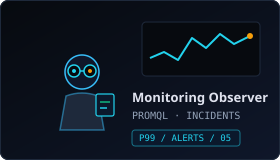

# Chapter 07 — Kubernetes & Prometheus Integrations

[Previous: Chapter 06 — Configuration, Auth & Security](./06-authentication-security-and-rbac.md) · [Docs Index](./README.md) · [Next: Chapter 08 — REST API & WebSockets](./08-api-and-websockets.md)

---

## 21. Kubernetes Integration (`KUBE_MODE`)

`src/server/services/kubernetesService.ts` connects to live Kubernetes clusters using `@kubernetes/client-node` v2 (`CoreV1Api`, `AppsV1Api`, `NetworkingV1Api`, `PolicyV1Api`, `AuthorizationV1Api`, and `Metrics`).

### 21.1 Connection Modes

| `KUBE_MODE`      | Behavior                                                                                                                                                                                                                           | Best Used For                                                                  |
| :--------------- | :--------------------------------------------------------------------------------------------------------------------------------------------------------------------------------------------------------------------------------- | :----------------------------------------------------------------------------- |
| `auto` (default) | Detects in-cluster ServiceAccount files (`/var/run/secrets/kubernetes.io/serviceaccount/token`); if absent, loads `KUBECONFIG_PATH` / `~/.kube/config`; if `K8S_API_SERVER` + `K8S_BEARER_TOKEN` exist, connects via bearer token. | Local laptops, bastions, Docker containers, and Pods without manual overrides. |
| `kubeconfig`     | Forces loading from `KUBECONFIG_PATH` (or `~/.kube/config`) and exposes all contexts in the TopBar cluster switcher.                                                                                                               | Multi-cluster workstation or jump-host management.                             |
| `incluster`      | Uses Pod ServiceAccount token and cluster CA inside Kubernetes.                                                                                                                                                                    | Deployed inside a Kubernetes `observability` namespace.                        |
| `token`          | Connects explicitly to `K8S_API_SERVER` using `K8S_BEARER_TOKEN` (respecting `K8S_SKIP_TLS_VERIFY`).                                                                                                                               | Isolated environments without kubeconfig files.                                |
| `disabled`       | Skips Kubernetes API client creation entirely (returns `kubernetesStatus: "disconnected"`).                                                                                                                                        | Prometheus-only nodes, Docker Compose dev demos, and isolated CI tests.        |

### 21.2 Operational Safety & Timeouts

- **10-Second Upstream Timeouts**: `withTimeout(..., 10_000)` prevents hung Kubernetes API control planes from exhausting Node.js request workers.
- **Bearer Token Redaction**: `sanitizeK8sError()` strips `Bearer <token>` strings before forwarding upstream errors to HTTP responses or audit entries.
- **PDB & Capacity Checked Drain**: `drainNode(nodeName, context)` cordons the node, verifies peer schedulable capacity across remaining nodes, inspects `PodDisruptionBudget` selectors (`minAvailable` / `maxUnavailable`), skips DaemonSet and mirror Pods safely, and evicts pods via `createNamespacedPodEviction` (`policy/v1`).

---

## 22. Prometheus & PromQL Integration

`src/server/services/prometheusService.ts` communicates directly with Prometheus HTTP API v1 when `PROMETHEUS_URL` is configured (must pass `http://` or `https://` Zod schema validation).

### 22.1 Endpoints Queried

| Prometheus Path            | Purpose                                                                                                                                 | Fallback When Unconfigured / Down            |
| :------------------------- | :-------------------------------------------------------------------------------------------------------------------------------------- | :------------------------------------------- |
| `/api/v1/status/buildinfo` | Verifies connectivity & Prometheus server version                                                                                       | `status: "disconnected"`                     |
| `/api/v1/query`            | Instant KPI values (`cpuPercent`, `memoryPercent`, `networkMbps`, `p99LatencyMs`) + user PromQL Explorer (`POST /api/prometheus/query`) | `null` KPI fields (UI renders `Unavailable`) |
| `/api/v1/query_range`      | Time-series curves across `15m`, `1h`, `6h`, `24h`                                                                                      | Empty `series: []` array                     |
| `/api/v1/rules`            | Active alerting rules and `firing`/`pending` alerts merged into `IncidentsScreen`                                                       | Empty rules & incidents list                 |

### 22.2 Built-In KPI Queries

Built-in overview cards evaluate standard Prometheus exporter metrics:

- **CPU Usage %**: `100 - (avg(rate(node_cpu_seconds_total{mode="idle"}[5m])) * 100)`
- **Memory Usage %**: `(1 - (sum(node_memory_MemAvailable_bytes) / sum(node_memory_MemTotal_bytes))) * 100`
- **Network Throughput (Mbps)**: `(sum(rate(node_network_receive_bytes_total{device!="lo"}[5m])) * 8) / 1000000`
- **HTTP P99 Latency (ms)**: `histogram_quantile(0.99, sum(rate(http_request_duration_seconds_bucket[5m])) by (le)) * 1000`

If your cluster uses different metric names, custom PromQL queries still execute directly via the **PromQL Explorer** (`POST /api/prometheus/query`) without restriction.

---

[Previous: Chapter 06 — Configuration, Auth & Security](./06-authentication-security-and-rbac.md) · [Docs Index](./README.md) · [Next: Chapter 08 — REST API & WebSockets](./08-api-and-websockets.md)
