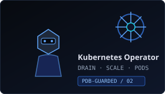

# Chapter 09 — Docker & Kubernetes Production Deployment



[Previous: Chapter 08 — REST API & WebSockets](./08-api-and-websockets.md) · [Docs Index](./README.md) · [Next: Chapter 10 — Backup, Upgrades & Uninstall](./10-operations-backup-and-upgrades.md)

---

## 25. Docker & Docker Compose Setup

While `ot` runs natively without containers, `Dockerfile` and `docker-compose.yml` support containerized deployments paired with Prometheus.

### 25.1 Security Properties of `Dockerfile` & `docker-compose.yml`

- **Non-Root Container User**: Runs cleanly inside an unprivileged container environment binding `0.0.0.0:1392` with persistent state in `/var/lib/obsidian-telemetry`.
- **No Fallback Default Secrets**: `docker-compose.yml` enforces:
  `SESSION_SECRET: ${SESSION_SECRET:?Set SESSION_SECRET (32+ random chars) in .env before starting Docker Compose}`
  Preventing silent weak-secret launches in production compose stacks.
- **Explicit Kubeconfig Opt-In**: `KUBE_MODE` defaults to `disabled` in `docker-compose.yml` until you uncomment the read-only kubeconfig volume mount (`- ${HOME}/.kube/config:/home/obsidian/.kube/config:ro`) and set `KUBE_MODE=kubeconfig`.

### 25.2 Launching with Docker Compose

```bash
cat <<'EOF' > .env
SESSION_SECRET=$(openssl rand -hex 32)
OT_ADMIN_PASSWORD=$(openssl rand -base64 18)
EOF

docker compose up -d --build
docker compose logs -f obsidian-telemetry
```

---

## 26. Kubernetes Manifests (`deploy/kubernetes/`)

Four production-ready YAML manifests are maintained in `deploy/kubernetes/`:

| Manifest             | Purpose                                                                                                      | Security & Reliability Role                                                                                                                                                                                                                                                    |
| :------------------- | :----------------------------------------------------------------------------------------------------------- | :----------------------------------------------------------------------------------------------------------------------------------------------------------------------------------------------------------------------------------------------------------------------------- |
| `pvc.yaml`           | `PersistentVolumeClaim` (`obsidian-telemetry-state`, `1Gi`, `ReadWriteOnce`)                                 | Replaces ephemeral `emptyDir` so local credentials, audit trail, and incident acknowledgements survive Pod restarts.                                                                                                                                                           |
| `rbac.yaml`          | `ServiceAccount` (`obsidian-telemetry`) + `ClusterRole` (`obsidian-telemetry-viewer`) + `ClusterRoleBinding` | **Default least-privilege read-only access**: `get`, `list`, `watch` on nodes, pods, `pods/log`, deployments, statefulsets, daemonsets, services, ingresses, events, PDBs, and `metrics.k8s.io`.                                                                               |
| `rbac-operator.yaml` | Optional `ClusterRole` (`obsidian-telemetry-operator`) + `ClusterRoleBinding`                                | **Opt-in cluster mutations**: explicitly grants `nodes` (`patch`), `pods` (`delete`), `pods/eviction` (`create`), `deployments` (`patch`), and `deployments/scale` (`get`, `patch`, `update`). `pods/exec` stays commented out.                                                |
| `deployment.yaml`    | `Deployment` + `ClusterIP` `Service`                                                                         | Runs non-root (`runAsUser: 1000`, `fsGroup: 1000`, `readOnlyRootFilesystem: true`, `allowPrivilegeEscalation: false`, `capabilities.drop: ["ALL"]`), mounts PVC at `/var/lib/obsidian-telemetry`, injects secrets from `obsidian-telemetry-secrets`, and probes `/api/health`. |

### Deployment Commands

```bash
# 1. Create namespace and strong random secrets
kubectl create namespace observability
kubectl create secret generic obsidian-telemetry-secrets \
  -n observability \
  --from-literal=session-secret="$(openssl rand -hex 32)" \
  --from-literal=admin-token="$(openssl rand -hex 24)" \
  --from-literal=operator-token="$(openssl rand -hex 24)"

# 2. Apply persistent storage, read-only RBAC, and deployment
kubectl apply -f deploy/kubernetes/pvc.yaml
kubectl apply -f deploy/kubernetes/rbac.yaml
kubectl apply -f deploy/kubernetes/deployment.yaml

# 3. (Optional) Enable cluster mutations (cordon, drain, pod delete, scale)
kubectl apply -f deploy/kubernetes/rbac-operator.yaml

# 4. Port-forward locally for immediate verification
kubectl -n observability port-forward svc/obsidian-telemetry 1392:80
```

---

[Previous: Chapter 08 — REST API & WebSockets](./08-api-and-websockets.md) · [Docs Index](./README.md) · [Next: Chapter 10 — Backup, Upgrades & Uninstall](./10-operations-backup-and-upgrades.md)
