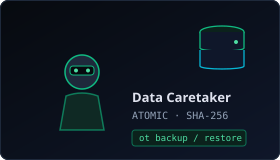

# Chapter 10 — Backup, Restore, Upgrades & Uninstallation



[Previous: Chapter 09 — Docker & Kubernetes Deployment](./09-deployment-containers-and-k8s.md) · [Docs Index](./README.md) · [Next: Chapter 11 — Testing, CI & Standards](./11-testing-and-ci.md)

---

## 27. Backup, Restore & Disaster Recovery

Obsidian Telemetry includes native, cryptographically verified backup and restore workflows in both `StateStore` and the `ot` CLI.

### 27.1 Creating an Integrity-Stamped Backup (`ot backup`)

```bash
ot backup
# or specify an explicit output file:
ot backup /secure-backups/ot-prod-$(date +%F).json
```

`StateStore.exportBackup()` packages `config.json`, `credentials.json`, `state.json`, and `audit.jsonl` into a single JSON bundle stamped with a **SHA-256 checksum** over the payload and written atomically with `0o600` permissions.

> Treat backup bundles as sensitive secrets because `credentials.json` inside the archive contains the instance `sessionSecret` and user `scrypt` password hashes.

### 27.2 Verifying & Restoring (`ot restore`)

```bash
ot restore /secure-backups/ot-prod-2026-11-14.json
```

`ot restore`:

1. Verifies file existence and parses the archive schema (`format: "obsidian-telemetry-backup"`).
2. Recomputes the payload SHA-256 digest and compares it via `crypto.timingSafeEqual`. If any character was altered or truncated, restoration aborts **before modifying any disk file**.
3. Stops the running daemon gracefully (if active), rotates pre-restore `.bak` files cleanly, writes restored state atomically, and restarts the service if it had been running.

### 27.3 Automatic Crash Recovery (`.bak` & `.corrupt.<ts>`)

If unexpected power loss or manual editing corrupts `config.json`, `credentials.json`, or `state.json`:

1. The invalid file content is quarantined atomically to `<file>.corrupt.<timestamp>` for post-mortem inspection.
2. `StateStore` automatically restores the last known-good `<file>.bak` snapshot without silent data loss.

---

## 28. Upgrades, Password Rotation & Breaking Changes

### 28.1 Self-Updating via `ot update`

```bash
ot update
```

`cmdUpdate()` performs a safe cross-platform sequence specifically engineered to avoid Windows file-lock (`EBUSY`/`EPERM`) errors:

1. Checks `obsidian.pid` and cleanly stops the running service (`cmdStop()`) **before** overwriting package files.
2. Detects the active install prefix (`~/.local/share/obsidian-telemetry/npm`, Windows `%LOCALAPPDATA%\ObsidianTelemetry\npm`, or global prefix) and executes `npm install -g --no-fund --no-audit obsidian-telemetry@latest`.
3. Automatically restores startup if the npm upgrade fails, or launches the upgraded release cleanly if Obsidian Telemetry was running beforehand.

### 28.2 Password Rotation (`ot passwd`)

```bash
# Interactive prompt (TTY)
ot passwd admin

# Non-interactive script or recovery
ot passwd admin --password "NewStrongPassword123!"
```

For in-browser password rotation by signed-in users, open **Session & RBAC Authentication** in the TopBar; `POST /api/auth/password` verifies the current password, updates `credentials.json`, and issues a fresh session cookie + `csrfToken`.

### 28.3 Semantic Versioning & Schema Migrations

- Follows **SemVer 2.0.0** (`1.0.0`): patch increments fix defects, minor increments add backward-compatible API/UI/CLI capabilities, major increments document breaking config or storage transitions in `CHANGELOG.md`.
- Every JSON store tracks `schemaVersion`. Future schema bumps write `<file>.bak` before migrating on load.

---

## 29. Uninstallation & Clean Removal (`ot uninstall`)

```bash
# Interactive confirmation prompt
ot uninstall

# Unattended / CI script removal
ot uninstall --yes
```

`ot uninstall` cleans strictly Obsidian Telemetry-managed resources without touching external Kubernetes configs (`~/.kube/config`) or Prometheus installations:

1. Sends `SIGTERM` to gracefully stop the background service.
2. Deletes `configDir` (`config.json`, `credentials.json`, `.bak`) and `dataDir` (`state.json`, `audit.jsonl`, `obsidian.pid`, `logs/server.log*`).
3. Removes `OT_HOME` if empty.
4. Removes `~/.local/bin/ot` only if it targets `obsidian-telemetry`.
5. Executes `npm uninstall -g obsidian-telemetry` against the detected install prefix.

---

[Previous: Chapter 09 — Docker & Kubernetes Deployment](./09-deployment-containers-and-k8s.md) · [Docs Index](./README.md) · [Next: Chapter 11 — Testing, CI & Standards](./11-testing-and-ci.md)
