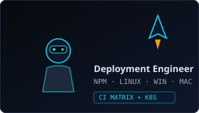
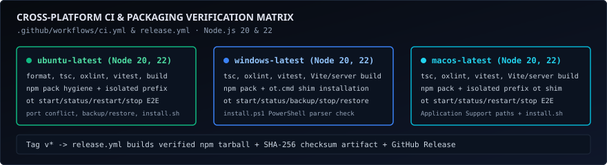

# Chapter 11 — Testing, CI/CD Matrix & Code Standards

[Previous: Chapter 10 — Backup, Upgrades & Uninstall](./10-operations-backup-and-upgrades.md) · [Docs Index](./README.md) · [Next: Chapter 12 — Limitations, Troubleshooting & FAQ](./12-limitations-troubleshooting-and-faq.md)

---

## 30. Testing Architecture

Obsidian Telemetry maintains three automated Vitest suites (`npm test`) plus full packaging/CLI end-to-end verification:

| Suite File                      | Environment             | Verified Behaviors                                                                                                                                                                                                                                                                                                                                                                                                                                                                                                                                                       |
| :------------------------------ | :---------------------- | :----------------------------------------------------------------------------------------------------------------------------------------------------------------------------------------------------------------------------------------------------------------------------------------------------------------------------------------------------------------------------------------------------------------------------------------------------------------------------------------------------------------------------------------------------------------------- |
| `tests/server.unit.test.ts`     | Node                    | Config precedence (`OT_HOST`, `OT_PORT`, `AUTH_MODE`), production placeholder secret rejection, `resolvePlatformPaths` across Linux/macOS/Windows/`OT_HOME`, `scrypt` hashing, atomic write uniqueness, `.bak` & `.corrupt.<ts>` crash recovery, `exportBackup`/`importBackup` SHA-256 integrity & tamper rejection, `rotateLogIfNeededSync`, `parseCookies` malformed percent-encoding safety, HMAC cookie signing/expiry, `AuditLogger` ring bounds, `IncidentService` merges, K8s CPU/memory parsing, PDB selector matching, and Prometheus HTTP responses.           |
| `tests/api.integration.test.ts` | Supertest + Express     | `/api/health` secret safety, `AUTH_MODE=token` gating, `HttpOnly`/`SameSite=Strict` + conditional `Secure` cookie attributes, local password login & CSRF enforcement (`403` missing vs `200` valid), password change rotating CSRF token, `5`-failure brute-force HTTP `429` + `Retry-After` lockout, `Cache-Control: no-store`, explicit `mode=demo` vs `disconnected`, RBAC role denial (`403`), demo mutation rejection (`400`), Zod input validation, and RFC 7239 `Forwarded` / `X-Forwarded-For` proxy handling without `express-rate-limit` validation warnings. |
| `tests/frontend.test.tsx`       | JSDOM + Testing Library | Disconnected empty-state onboarding screen, explicit Demo switch flow, KPI `Unavailable` rendering on missing Prometheus series, search + status filter state, Confirmation modal gating before mutating calls, and Log regex filter error safety.                                                                                                                                                                                                                                                                                                                       |

---

## 31. CI/CD Workflows & Release Pipeline

  

### 31.1 Continuous Integration (`.github/workflows/ci.yml`)

Runs on every push to `main` and every Pull Request across **three native OS runners** and two Node LTS lines (`20` and `22`):

1. **Ubuntu Linux (`ubuntu-latest`)**: `prettier --check .`, `tsc --noEmit`, `oxlint --deny-warnings`, `vitest run`, `npm run build`, `npm pack` hygiene verification (rejecting `.env`, `.git`, `src/`, `tests/`), isolated npm prefix install, `ot --version`, `ot start`, live HTTP `/api/health` + dashboard HTML checks, explicit port-conflict fail-fast check, `ot status`, `ot restart`, `ot backup`, `ot stop`, `ot restore`, `ot uninstall --yes`, plus `sh -n install.sh`.
2. **Windows Server (`windows-latest`)**: Full typecheck, lint, Vitest suite, build, `npm pack`, isolated prefix install generating `ot.cmd`, PowerShell lifecycle checks (`ot start`, HTTP probe on `127.0.0.1:1392`, `ot status`, `ot backup`, `ot stop`, `ot restore`, `ot uninstall --yes`), and AST syntax validation of `install.ps1`.
3. **macOS (`macos-latest`)**: Full typecheck, lint, Vitest suite, build, `npm pack`, isolated prefix install, live daemon HTTP & CLI lifecycle (`ot start`, `ot status`, `ot restart`, `ot stop`, `ot uninstall --yes`), `~/Library/Application Support/Obsidian Telemetry` verification, and `sh -n install.sh`.

### 31.2 Release Automation (`.github/workflows/release.yml`)

Triggered on semantic tags (`v*`) or manual `workflow_dispatch`: re-runs full verification, packs the deterministic npm tarball, generates `obsidian-telemetry-<version>.tgz.sha256`, attaches both artifacts to a GitHub Release, and exposes an optional manual `publish_npm` path guarded by `NPM_TOKEN` without embedding any credentials in repository files.

---

## 32. Code Quality, Formatting & TypeScript Conventions

| Check                       | Command                                                            | Enforcement Rule                                                                                     |
| :-------------------------- | :----------------------------------------------------------------- | :--------------------------------------------------------------------------------------------------- |
| **TypeScript Strict Check** | `npm run lint` (`tsc --noEmit`)                                    | Zero type errors across client (`src/`) and server/CLI (`server.ts`, `src/server/`, `src/cli/`).     |
| **Static Analysis**         | `npm run lint:code` (`oxlint --deny-warnings src server.ts tests`) | Zero warnings allowed across all source and test files.                                              |
| **Formatting**              | `npm run format:check` (`prettier --check .`)                      | Consistent indentation, quotes, and Markdown/YAML formatting.                                        |
| **Dual Compilation**        | `npm run build`                                                    | Builds browser bundle into `dist/` and emits compiled JS + `.d.ts` declarations into `dist-server/`. |

---

[Previous: Chapter 10 — Backup, Upgrades & Uninstall](./10-operations-backup-and-upgrades.md) · [Docs Index](./README.md) · [Next: Chapter 12 — Limitations, Troubleshooting & FAQ](./12-limitations-troubleshooting-and-faq.md)
