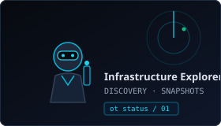
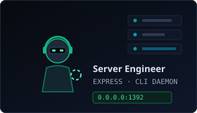
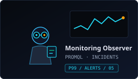
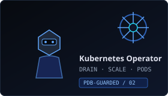
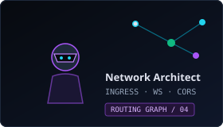
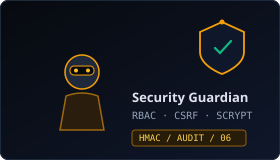
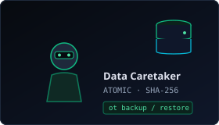
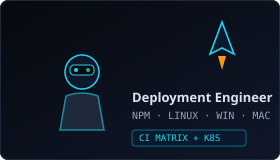

# Obsidian Telemetry — Engineering & Operations Book

  

> Comprehensive engineering documentation covering all 41 operational, architectural, security, packaging, deployment, and maintenance topics for **Obsidian Telemetry** (`devlopergit04/Obsidian-Telemetry` / `obsidian-telemetry` / CLI `ot`).

---

## Complete Chapter & Topic Index (1–41)

| Chapter | Document                                                                                       | Topics Covered                                                                                                                                                                                                  |
| :------ | :--------------------------------------------------------------------------------------------- | :-------------------------------------------------------------------------------------------------------------------------------------------------------------------------------------------------------------- |
| **01**  | [Introduction, Installation & Quick Start](./01-introduction-and-quickstart.md)                | 1. Introduction & Philosophy · 2. Why Obsidian Telemetry Exists · 3. System Requirements · 4. Quick Start · 5. Supported Platforms · 6. Installation via npm · 7. Installation via `install.sh` & `install.ps1` |
| **02**  | [CLI Reference & Network Binding](./02-cli-and-networking.md)                                  | 8. CLI Command & Flag Reference · 9. Port, Host & Network Binding (`0.0.0.0:1392`) · 10. Accessing from Localhost, LAN & Remote Servers                                                                         |
| **03**  | [Reverse Proxies, TLS & Autostart Services](./03-reverse-proxy-tls-and-systemd.md)             | 11. Reverse Proxy Setup (Nginx, Caddy, Apache, Traefik) · 12. Autostart & Service Managers (systemd, launchd, Windows Task Scheduler)                                                                           |
| **04**  | [System Architecture & Technology Stack](./04-architecture-and-stack.md)                       | 13. Architecture Overview (Process, Backend, Frontend, CLI, Storage Lifecycle) · 14. Technology Stack & Dependency Rationale                                                                                    |
| **05**  | [Frontend Views & Interactive Controls](./05-frontend-and-views.md)                            | 15. Complete Walkthrough of Views `01`–`06`, Modals, Command Palette & Drawers                                                                                                                                  |
| **06**  | [Configuration, Auth, RBAC & Security](./06-authentication-security-and-rbac.md)               | 16. Environment Variables · 17. Persistent Data Directories · 18. Authentication System · 19. Authorization & RBAC · 20. Security Architecture & Hardening Checklist                                            |
| **07**  | [Kubernetes & Prometheus Integrations](./07-kubernetes-and-prometheus.md)                      | 21. Kubernetes Integration Modes · 22. Prometheus & PromQL Integration                                                                                                                                          |
| **08**  | [REST API & WebSocket Protocol](./08-api-and-websockets.md)                                    | 23. Complete REST API Reference · 24. WebSocket Protocol (`/ws/logs`, `/ws/exec`)                                                                                                                               |
| **09**  | [Docker & Kubernetes Manifests Deployment](./09-deployment-containers-and-k8s.md)              | 25. Docker & Docker Compose Production Setup · 26. Kubernetes Manifests (`pvc.yaml`, `rbac.yaml`, `rbac-operator.yaml`, `deployment.yaml`)                                                                      |
| **10**  | [Backup, Restore, Upgrades & Uninstallation](./10-operations-backup-and-upgrades.md)           | 27. Backup, Restore & Crash Recovery · 28. Upgrades, Password Rotation & Breaking Changes · 29. Clean Uninstallation                                                                                            |
| **11**  | [Testing, CI/CD Matrix & Code Standards](./11-testing-and-ci.md)                               | 30. Testing Architecture · 31. CI/CD Workflows (`ci.yml`, `release.yml`) · 32. Formatting, Linting & TypeScript Conventions                                                                                     |
| **12**  | [Performance, Limitations, Troubleshooting & FAQ](./12-limitations-troubleshooting-and-faq.md) | 33. Performance & Scaling Limits · 34. Known Limitations · 35. Troubleshooting Guide · 36. Frequently Asked Questions                                                                                           |
| **13**  | [Contributing, Governance, Changelog & Roadmap](./13-governance-contributing-and-roadmap.md)   | 37. Contributing Guide · 38. Security Policy · 39. Governance & MIT License · 40. Changelog Summary · 41. Roadmap                                                                                               |

---

## Operator Personas

<table>
  <tr>
    <td align="center" width="25%"> <a href="./01-introduction-and-quickstart.md">Start &amp; Discovery</a></td>
    <td align="center" width="25%"> <a href="./02-cli-and-networking.md">CLI &amp; Networking</a></td>
    <td align="center" width="25%"> <a href="./07-kubernetes-and-prometheus.md">Telemetry &amp; PromQL</a></td>
    <td align="center" width="25%"> <a href="./09-deployment-containers-and-k8s.md">Kubernetes RBAC</a></td>
  </tr>
  <tr>
    <td align="center" width="25%"> <a href="./03-reverse-proxy-tls-and-systemd.md">Proxies &amp; Ingress</a></td>
    <td align="center" width="25%"> <a href="./06-authentication-security-and-rbac.md">Auth &amp; Security</a></td>
    <td align="center" width="25%"> <a href="./10-operations-backup-and-upgrades.md">Backup &amp; Recovery</a></td>
    <td align="center" width="25%"> <a href="./11-testing-and-ci.md">CI Matrix &amp; Releases</a></td>
  </tr>
</table>

---

[Back to Main README](../README.md) · [Next: Chapter 01 — Introduction & Quick Start](./01-introduction-and-quickstart.md)
